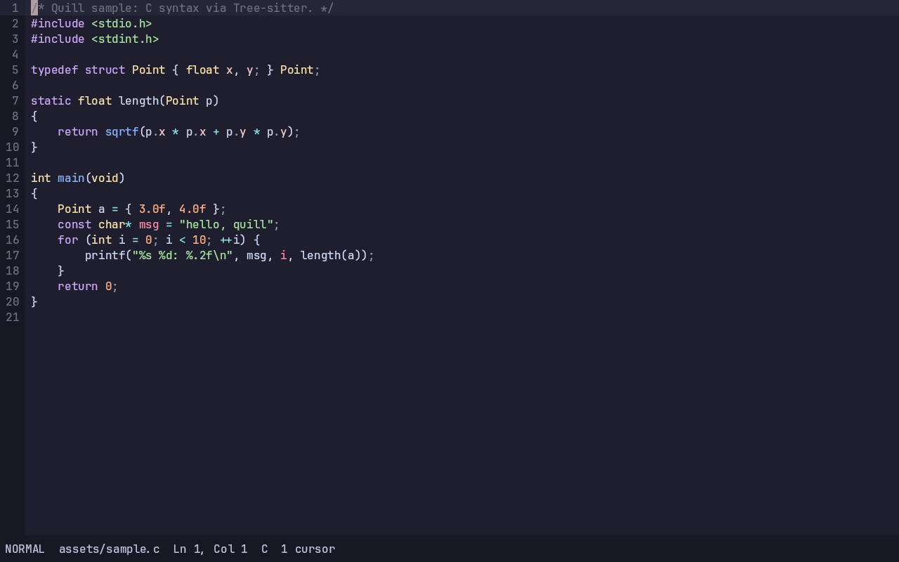

# Quill

A high-performance Vulkan code/text editor backed by **`mu_quill`**, with
**Tree-sitter-only** syntax highlighting. No LSP. No autocompletion.



## Features

- `mu_quill` chunked-gap buffer with zero-copy Tree-sitter input and a
  one-descent sequential viewport walk.
- FreeType + HarfBuzz + fontconfig text: hinted grayscale AA, shaping cache,
  fallback faces, HiDPI, quarter-pixel atlas phases, integer code grid.
- Gamma-correct linear blending through an sRGB Vulkan swapchain.
- Incremental Tree-sitter parsing (`ts_tree_edit` + old-tree reparse) and
  visible-range highlight queries. Languages: C, JSON, Rust, Python, JavaScript.
- Modal editing (Normal/Insert/Visual char/line/block), counts, operators,
  text objects, registers, dot repeat, and search.
- Hybrid multicursor selection set with grouped undo (`Ctrl-n`, `Alt-click`).
- Telescope-like picker: files, buffers, live grep, symbols, recent, commands,
  keymaps, help; fuzzy matching, preview, async cancellable jobs.
- Neovide-style spring scroll/cursor motion, cursor trail, smooth blink, and
  reduced-motion fallback.
- Optional dramatic camera (`dramatic = true`): parks the cursor at a lead point
  of the viewport and springs the page toward it on both axes instead of
  scrolling the minimum distance. Pure scroll policy, opt-in, one branch per
  frame when off. See `docs/MODAL.md`.
- 17 combinable cursor VFX modes (Neovide ports + Quill extras).
- Optional background image (cover/contain/stretch) and editor chrome opacity;
  both are zero-cost when unconfigured. See `docs/APPEARANCE.md`.
- Custom themes: a loadable palette file replaces the built-in Noir;
  ships with Naysayer, Catppuccin, Dracula, Gruvbox, Nord, Tokyo Night, One Dark,
  Solarized Dark/Light, and Rosé Pine Dawn. Zero per-frame cost. See
  `docs/THEMES.md`.
- Session restore: reopens the last buffers with cursor and scroll positions on
  launch; startup/shutdown only. See `docs/SESSION.md`.
- Integrated terminal: a PTY-backed shell (libvterm) for compiling and running
  code without leaving the editor; text-only, zero-cost when closed. See
  `docs/TERMINAL.md`.
- Undo/redo with coalesced typing, grouped multicursor edits, selection,
  clipboard, mouse hit-testing, line numbers, status bar, zoom, damage-driven
  redraw.
- Headless Vulkan offscreen rendering + PNG screenshots for CI.

## Build (Debian 13 / Ubuntu)

```sh
sudo apt-get install -y build-essential pkg-config \
  libvulkan-dev vulkan-tools glslang-tools vulkan-validationlayers \
  libglfw3-dev libfreetype-dev libharfbuzz-dev libfontconfig-dev libpng-dev \
  fonts-jetbrains-mono fonts-noto-core

cd quill
make -j2
make check
```

Tree-sitter runtime and grammars are vendored under `third_party/` (MIT).
The editor links the system Vulkan loader; in a GPU-less sandbox it will use
Mesa llvmpipe (software). Any timing from llvmpipe is labelled software.

## Run

```sh
./quill assets/sample.c          # interactive (needs a display)
./quill assets/sample.rs
./quill /path/to/project         # open the file picker rooted at a folder
./quill --headless assets/sample.c --screenshot out.png --validation
./quill --headless assets/sample.py --screenshot py.png --size 20 --scale 2
```

Passing a directory opens Quill on an empty buffer with the files picker
rooted there, so the first file can be chosen immediately. The same root is
used by live grep and project symbols for the rest of the session.

Headless flags: `--width`, `--height`, `--size`, `--scale`, `--top-line`,
`--screenshot`, `--theme`, `--validation`.

On Wayland, Quill disables GLFW's GTK-based libdecor plugin, which avoids
loading GTK/GLib/ICU and saves roughly 20 MiB of resident memory. Window
decorations come from the compositor or GLFW's fallback.

## Controls

Quill starts in **Normal mode**. See `docs/MODAL.md` for the full keymap.

| Key | Action |
|---|---|
| `i a o I A O` | enter Insert |
| `Esc` | Normal / collapse multicursor |
| `h j k l w b e 0 $ gg G` | motions |
| `d c y` + motion | delete / change / yank |
| `dd cc yy` | line operators |
| `v V Ctrl-v` | visual char / line / block |
| `p P u Ctrl-r .` | put / undo / redo / repeat |
| `/ ? n N * #` | search |
| `Ctrl-n` | multicursor add-next |
| `Alt-click` | add cursor |
| `Space f f` | file picker |
| `Space f g` | live grep picker |
| `Space t` | open / focus terminal |
| `Ctrl-:` | toggle terminal / editor |
| `Ctrl-\ Ctrl-n` | leave terminal (back to editor) |
| `Ctrl-Shift-C` / `Ctrl-Shift-V` | copy / paste in terminal |
| `:` | command palette |
| `Ctrl-s` | save |
| `Ctrl-d/u/f/b` | scroll |
| Mouse drag / wheel | select / scroll |

## Tests

```sh
make check
```

Runs core, syntax, font, frame, modal, picker, theme, session, terminal, and
headless Vulkan tests (17 total), then renders C/Rust/Python screenshots with the
Khronos validation layer enabled. ASan/UBSan gates are documented in
`docs/PERFORMANCE.md`.

## Documentation

- `docs/MODAL.md` — modal editing, multicursor, picker, motion config.
- `docs/VFX.md` — the 17 cursor VFX modes and how to combine them.
- `docs/APPEARANCE.md` — optional background image and editor opacity.
- `docs/THEMES.md` — custom palette files and the built-in themes.
- `docs/SESSION.md` — session restore (buffers, cursor, scroll).
- `docs/TERMINAL.md` — integrated terminal (PTY + libvterm).
- `docs/MEMORY.md` — measured RSS breakdown after opening `src/main.c`.
- `docs/MODAL_PLAN.md` — approved Round-11 plan.
- `docs/RESEARCH.md` — font-rendering research, citations, design choices.
- `docs/ARCHITECTURE.md` — modules, data layout, frame pipeline, AGENT.md notes.
- `docs/PERFORMANCE.md` — measured evidence, environment, before/after.
- `results/bench_frame.csv` — raw benchmark CSV.

## Known limitations

- BiDi itemization is not complete; lines are shaped LTR with fallback faces.
- Color emoji are folded to grayscale coverage in the R8 atlas.
- LCD subpixel rendering is intentionally disabled.
- Full-file incremental reparse on large files is debounced (30 ms) rather than
  run on every keystroke.
- Undo payload is a bounded append-only arena per document session.
# quil
# quil
