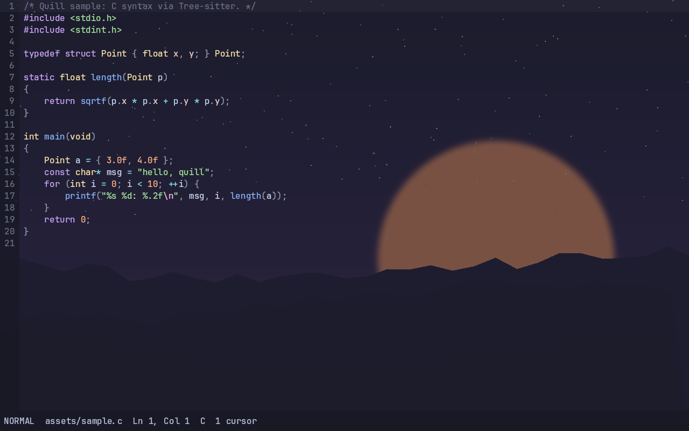

# Appearance: background image & editor opacity

Two optional, independent features. Both default to a **zero-cost path**: with
no background image and `editor_opacity = 1.0`, Quill allocates no texture,
creates no extra pipeline, records no extra draw, and does no per-glyph or
per-quad work beyond the original renderer.



## Background image

Drawn fullscreen beneath the editor chrome. Supported formats: PNG, JPEG, BMP,
TGA (decoded by the vendored `stb_image`, no new link dependencies).

| Config key | Values | Default | Meaning |
|---|---|---|---|
| `background_image` | path, or `none`/empty | `none` | Image to draw behind the editor. |
| `background_fit` | `cover` \| `contain` \| `stretch` | `cover` | How the image fills the window. |

- **cover** — scale to cover the window, cropping the overflow (no letterbox).
- **contain** — scale to fit, centered; the leftover bars show the theme color.
- **stretch** — scale to the window exactly (may distort the aspect ratio).

The image is loaded once when set (startup or `vk_render_set_background`), not
per frame. A bad path logs a warning and the editor keeps running without a
background.

## Editor opacity

`editor_opacity` (0.0–1.0, default `1.0`) fades **only the chrome**: the editor
background, gutter, current-line highlight, selections, search matches, status
bar, picker panel, and search prompt. **Text, the cursor, and cursor VFX stay
fully opaque**, so readability is preserved while the background shows through.

Lower it to reveal a background image, e.g. `editor_opacity = 0.85`. With no
background image it simply makes the chrome more translucent over the theme
clear color.

## Ways to configure

Config file (`quill.conf`, see `quill.conf.example`):
```
background_image = /path/to/wallpaper.png
background_fit = cover
editor_opacity = 0.85
```

CLI (both GUI and `--headless`):
```
quill --background wall.png --background-fit contain --editor-opacity 0.8
```

Command palette (`:`): `Editor Opacity: 100% … 50%` and `Background Image: None`.

## Reproduce the demo screenshot

```
./quill --headless assets/sample.c --screenshot out.png \
        --background assets/background_demo.png --editor-opacity 0.82 --validation
```

## Implementation notes

- `src/render_vk.c`: `vk_render_set_background()` uploads the image to an
  sRGB `VkImage` and lazily builds a dedicated fullscreen-triangle pipeline.
  When disabled, every background handle is `VK_NULL_HANDLE` and the frame
  path skips the block entirely.
- `src/frame.c`, `src/picker.c`, `src/main.c`: chrome alpha is multiplied by
  `editor_opacity` only when it is `< 1.0`.
- The cursor loop reads `MotionConfig` through a pointer (it previously copied
  the struct per cursor); the appearance fields therefore never enter the hot
  per-cursor path.

## Verification

- `tests/test_appearance.c`: defaults, opacity scaling (chrome fades, glyphs do
  not), clamping, background load/render/disable, and graceful bad-path handling.
- `make check`: 14/14 pass + 3 llvmpipe screenshots.
- ASan + UBSan clean over the loader, opacity, config, and picker paths.
- Disabled-path overhead measured against the pre-appearance commit: see
  `docs/PERFORMANCE.md` and `results/bench_appearance.csv` (geomean ~1.0×).
