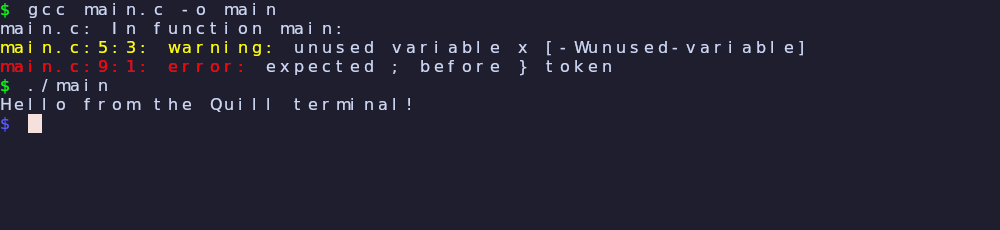

# Integrated terminal

A simple, text-only terminal inside the editor: open a shell, run `gcc`, `make`,
`git`, `./a.out`, see colored output, scroll back, and jump back to editing. It
is deliberately **not** a full terminal emulator — no kitty graphics, sixel,
images, or other display-protocol extras.

## Open / close / leave

| Action | How |
|---|---|
| Open a terminal | `Ctrl-:` (Ctrl+Shift+`;`), or `<Space>t`, or palette `Terminal: Open` |
| Return to the editor (terminal keeps running) | `Ctrl-:` again, or `Ctrl-\` then `Ctrl-n` |
| Reopen the running terminal | `<Space>t` or `Ctrl-:` again |
| Kill the terminal | palette `Terminal: Close` |
| Scroll back / forward | mouse wheel, or `Shift-PageUp` / `Shift-PageDown` |

While the terminal is focused, **every keystroke goes to the shell** (layout-
aware, like the editor), except `Ctrl-:`, which toggles back to the editor.
`Ctrl-\ Ctrl-n` is also accepted as the escape hatch back to Normal mode,
mirroring Neovim. The shell is `$SHELL` (fallback `/bin/sh`) on a real PTY with
`TERM=xterm-256color`, so colors, full-screen apps (`htop`, `vim`), and resize
(`SIGWINCH`) all work.

## What it supports

- Text + UTF-8, SGR colors (16 / 256 / truecolor), bold, underline, reverse,
  strikethrough.
- Cursor movement, erase, scroll regions, alternate screen, bracketed paste.
- A 2000-line scrollback ring.
- Window resize propagates to the child (`TIOCSWINSZ`).
- Default fg/bg follow the active **theme**; the 16 ANSI colors use a standard
  palette.

## What it intentionally skips

Kitty graphics protocol, sixel, inline images, OSC-52 clipboard, hyperlinks,
mouse reporting, and ligatures (each cell is shaped independently so font
ligatures never merge cells). This keeps it small and fast.

## How it works

- **PTY** — `forkpty()` spawns the shell; the master fd is non-blocking.
- **Parser** — the vendored **libvterm** (MIT, the same VT parser Neovim uses)
  turns bytes into a screen model. Quill does not hand-roll escape parsing.
- **Grid** — a flat row-major `TermCell` array (codepoint, fg, bg, attrs, width),
  refreshed from libvterm only when damaged, plus a fixed scrollback ring. All
  buffers are allocated at create/resize, never in the frame.
- **Render** — cells are emitted into the editor's existing `DrawList` (one
  background solid per non-default run, one glyph per cell) and drawn by the
  same Vulkan pipeline. Per-cell shaping reuses the font atlas cache. The
  primary face is required to be fixed-width; if the preferred families are
  absent, Quill selects another installed monospace face rather than silently
  stretching proportional glyphs across the grid. libvterm supplies characters
  and attributes, not glyph rasterization or font metrics.
- **Input** — libvterm encodes keys (`vterm_keyboard_key`/`unichar`), so arrows,
  Ctrl/Alt chords, and function keys produce the right escape sequences.

## Zero overhead when unused

With no terminal open, nothing polls, nothing renders, and no PTY exists. The
main loop's idle timeout is unchanged; the only editor-path addition is a single
predictable `term_active` branch. While a terminal is *visible*, the loop pumps
its PTY at ~8 ms cadence; that cost stops the moment you leave or close it.

## Implementation notes

- `src/terminal.{h,c}` — PTY lifecycle, libvterm glue, grid + scrollback, input,
  rendering. `src/main.c` — `term_open/close`, the `QMODE`-independent terminal
  input branch, render branch, resize, and cleanup.
- Vendored under `third_party/libvterm/` (built without `-Werror`, like the other
  third-party code).

## Verification

- `tests/test_terminal.c` drives a real PTY with a deterministic child: output
  parsing, SGR color, input echo, scrollback content, resize, and render.
- Fuzzed with 300 KB of random bytes (malformed escapes / invalid UTF-8) plus
  concurrent resize/scroll/input under ASan + UBSan: no crash, no report.
- `make check`: 17/17 pass + 3 llvmpipe screenshots.

## Possible follow-ups

Split panes (editor + terminal side by side), a `:make` command that jumps to
compiler errors, per-theme ANSI palettes, and a bold font face.
